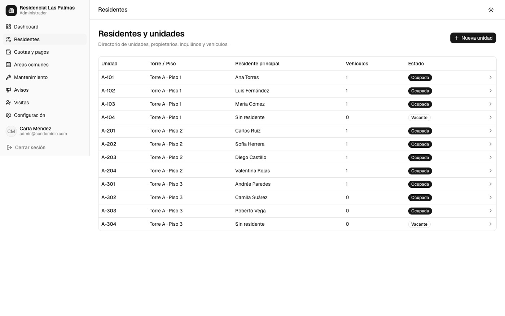
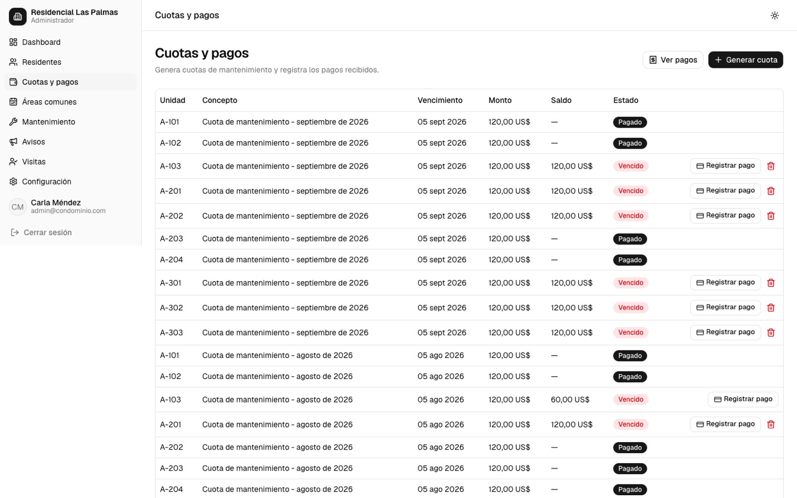
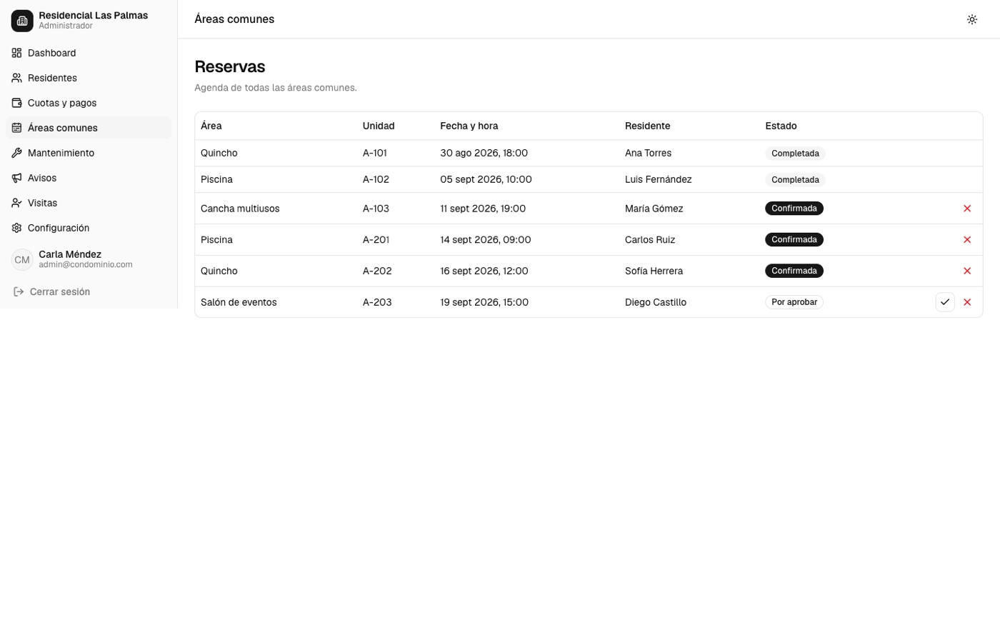
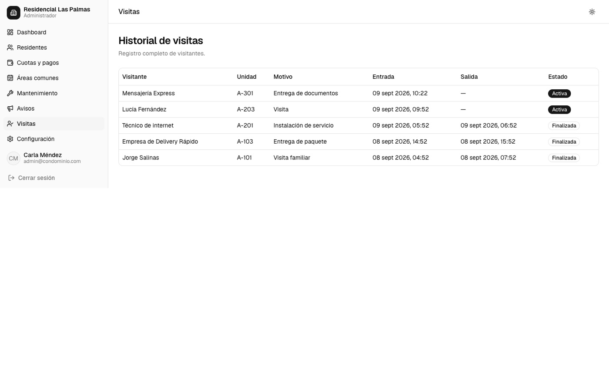
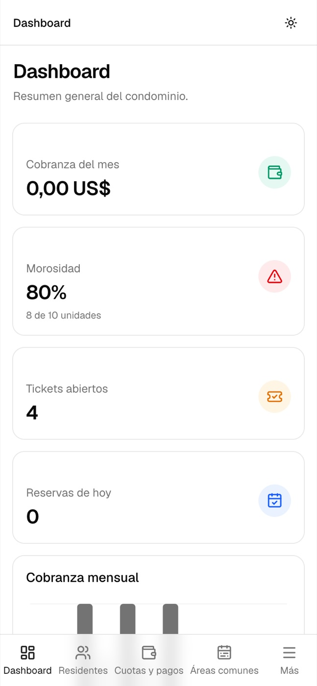
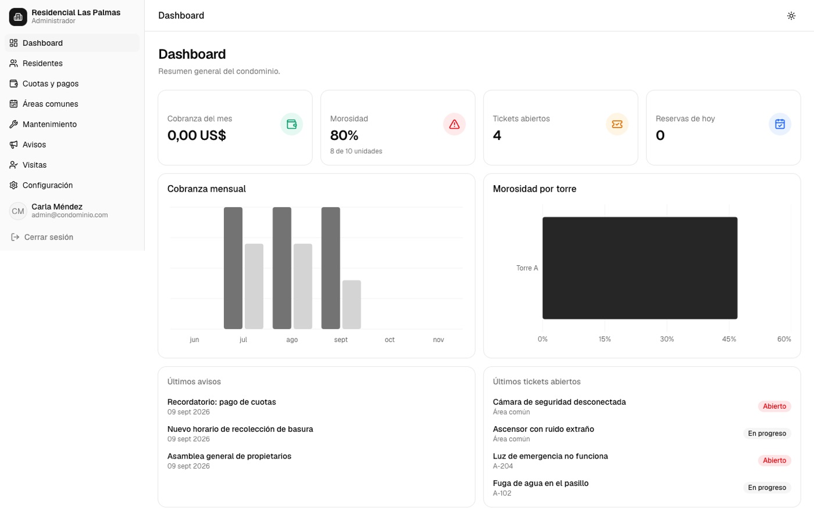

# Residencial Las Palmas — Control de Condominios

<!-- teaser:start -->
<p align="center">
  
</p>

<details><summary>Más capturas</summary>

<p align="center">
  
</p>

</details>
<!-- teaser:end -->


Aplicación web full-stack para la administración de un condominio: residentes y unidades, cuotas y pagos, reservas de áreas comunes, mantenimiento, avisos y control de visitas. Responsive (mobile-first) e instalable como PWA.

## Stack

Next.js (App Router) · TypeScript · Tailwind CSS + shadcn/ui (Base UI) · Prisma + SQLite · NextAuth v5 (Credentials) · Recharts

## Primeros pasos

```bash
npm install
cp .env.example .env   # ajustar AUTH_SECRET en producción
npx prisma migrate dev
npx prisma db seed
npm run dev
```

Abrir [http://localhost:3000](http://localhost:3000).

## Usuarios de prueba (creados por el seed)

| Rol | Correo | Contraseña |
|---|---|---|
| Administrador | admin@condominio.com | Admin123! |
| Guardia | guardia1@condominio.com | Guardia123! |
| Residente | residente1@condominio.com … residente9@condominio.com | Residente123! |

## Módulos

- **Residentes y unidades**: directorio de unidades, propietarios/inquilinos y vehículos.
- **Cuotas y pagos**: generación de cuotas (individual o masiva), registro de pagos y cálculo automático de saldo/morosidad. *Solo registro contable — no procesa pagos reales.*
- **Áreas comunes y reservas**: calendario de disponibilidad por bloques horarios, con aprobación opcional del administrador.
- **Mantenimiento**: tickets de incidencias con estado, prioridad y comentarios.
- **Avisos**: comunicados fijables con fecha de expiración opcional.
- **Visitas**: check-in/check-out de visitantes para el guardia.

## Scripts

```bash
npm run dev          # servidor de desarrollo (Turbopack)
npm run build         # build de producción (usa webpack para generar el service worker de la PWA)
npm run start          # servidor de producción
npm run lint            # ESLint
npm run db:migrate    # nueva migración de Prisma
npm run db:seed        # reiniciar los datos de ejemplo
npm run db:studio      # explorar la base de datos
```

## Notas técnicas

- **PWA**: `npm run build` debe correr con `--webpack` (ya configurado en el script) porque el plugin de PWA usado (`@ducanh2912/next-pwa`) se apoya en Webpack; con Turbopack (el bundler por defecto en Next.js 16) no genera el service worker. En desarrollo la PWA está deshabilitada.
- **Base de datos**: SQLite en `prisma/dev.db` (no se versiona). El esquema está pensado para poder migrar a PostgreSQL cambiando el `provider` y `DATABASE_URL` en `prisma/schema.prisma`.
- **Roles**: cada rol (`ADMIN`, `RESIDENT`, `GUARD`) tiene su propio árbol de rutas (`/admin`, `/residente`, `/guardia`) protegido por `src/proxy.ts` (el archivo de middleware de Next.js 16) y validado nuevamente en cada Server Action.
